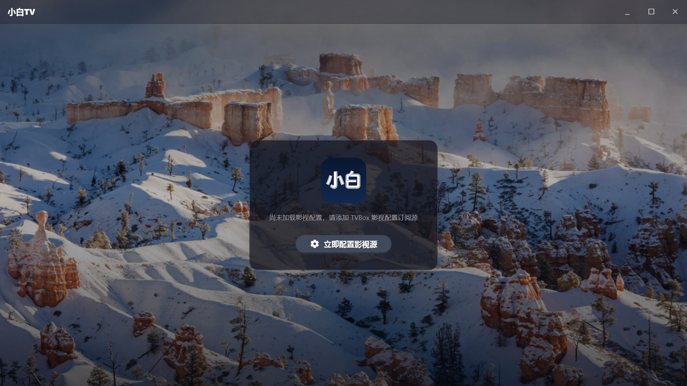

# 小白TV

一款Windows 桌面端的TVBOX壳衍生版。

  

  
  
  

## 简介

本项目初衷是个人自用方便，软件本身不提供、不托管任何内容源，也不内置订阅链接；播放内容完全来自你自行添加的配置。

## 核心亮点

- 可以使用安卓的TVBOX源，如：饭太硬，肥猫等大佬的源。支持多仓源，点击首页的线路可以切换多仓源内的源地址。

## 界面截图

### 首页

  

顶部分类导航 + 功能入口方块 + 站点分类与海报网格；站点与分类都能一键切换。

  

尚未导入影视配置时显示空态占位，点击「立即配置影视源」即可添加订阅源。

### 播放历史

按时间倒序记录剧集与观看进度，点击即从上次位置续播；保留条数可配置（30–500，默认 150）。

### 设置

  

配置源、直播源、通用、播放器与解码、快捷键与关于集中在设置中心。

##

## 功能特性

### 点播

- 首页分类浏览、海报瀑布流，站点与分类可快速切换。
- 分类页滚动到底自动加载下一页并增量追加，直到该分类取完；页码按站点声明推进，遇到不响应翻页的站点会自行收住而不是空转。
- 全局搜索逐站显示结果，结果可按站点筛选。在「设置 → 通用 → 聚合搜索站点」可为每份配置单独勾选参与搜索的站点。默认全选，取消所有勾选会暂停该配置的聚合搜索。
- 首页可从热门海报点缩略图选片。详情显示更新状态、线路和选集，以及同站同片上次看到的集数和进度。
- 播放历史与断点续播，保留条数可配置（30–500，默认 150）。
- 可选 TMDB 新版影片详情，在「设置 → 外观 → 影片详情」开启，经典布局仍默认。新版保留原站选集、收藏与续播，异步补充背景、简介、演员、豆瓣短评和相似推荐。
- 资料／图片失败时只补经过同片核验的豆瓣缺项：横版海报优先、横剧照回退，演员头像按同片同名回退；不放大竖封面，不用不确定的同名片拼接资料。

### 直播

- 默认读取点播源内的地址，也可以在「设置 → 直播源」导入 TXT、M3U、M3U8 或 JSON 频道表，同一路径再次导入可刷新频道。
- 频道按来源分组，支持分组浏览与频道搜索。
- EPG 节目单：查看频道当前与后续节目。
- 播放画面中部偏左（含中线）滚轮上滚上一台、下滚下一台，右侧仍调节音量。

### 播放器

- libmpv 内核，支持 D3D11VA、D3D11VA（拷回模式）、DXVA2 硬件解码，并显示硬解状态。
- 倍速菜单提供 0.5–3.0 倍速，同片切集、换线和刷新可保留手选倍率。可调音量与画面缩放，还可在画面左上角显示实际分辨率。
- 点播弹幕可按片名、集数手动搜索匹配。
- 视频轨、音轨、字幕轨切换，支持关闭字幕；音轨/字幕菜单按真实引擎选择更新。
- mpv 文本字幕可按 75%、100%、125%、150%、200% 调整字号并恢复默认；位图字幕及 MDK / Media Foundation 不提供此字号能力。
- mpv 可从系统文件选择器挂载 SRT、ASS、SSA、VTT，取消、坏文件及换片不会串用上一片字幕。
- 片头 / 片尾跳过，按毫秒精确配置。
- 自动换线与手动换线，失败提示统一呈现。
- 键盘快捷键与鼠标操作并行。
- 播放/暂停/缓冲期间维持伴随服务租约，代理异常时有界恢复，保留播放位置。
- 点播自然结束后自动切下一集，可在「设置 → 播放器与解码」关闭；点播失败后可直接重选线路与剧集。
- Windows 播放页可在 mpv、MDK 与 Media Foundation 之间切换，默认仍为 mpv。格式、字幕与硬解能力以内核和系统支持为准，不承诺新内核普遍更省电。

### 界面与交互

- 壁纸内置bing每日壁纸，点击首页的壁纸自动更换，无需复杂设置。
- 点击线路切换设置好的源地址，如果当前使用的是多仓源则切换多仓内部地址。
- 时间左侧的首页源切换按钮，点击切换源地址的首页源，如果调用失败则返回默认的豆瓣首页。
- 分类除了内置分类，还会读取源地址的分类，在顶部显示。
- 点击搜索会进入搜索界面，调用源地址的搜索结果。

## 下载与升级

适用于 Windows 10 / 11 x64，随包提供 Java、Node、Python、PHP 和媒体运行时。安装版与便携版从项目 GitHub Releases 获取：https://github.com/xiaobyes/xiaobaitv/releases/latest，摘要以该次发行附带的 SHA256SUMS 为准。

安装版请先完全退出旧程序再运行安装向导；便携版解压到新的可写目录后运行 `小白TV.exe`。升级前在旧版设置中导出备份，记下实际资料目录并退出；确认配置、历史、收藏和偏好正常前，保留旧目录与备份。

第三方组件及 MDK／FFmpeg 的分发材料见 [第三方许可](THIRD_PARTY_LICENSES.md)。

## 从源码构建

弹幕与共享跳过片段依赖维护者自部署的在线服务，直接用源码构建时这两项功能不会出现（其余功能不受影响）。

后台服务需维护者自行部署并配置 `config/app.env`；普通用户直接下载 Releases 安装包即可，无需任何配置。

从源码制作 Windows 完整包时，`companion/noderuntime/node.exe` 使用 Node.js 24.19.0 的 Windows x64 官方二进制，SHA-256 见 `companion/noderuntime/provenance.json`。PHP 可用 `scripts/setup_php_runtime.ps1` 准备。已有同版本便携包的开发者也可在校验 ZIP 后，将包内 `companion/dist/` 的 `noderuntime`、`phpruntime`、`pyruntime` 分别复制到源码的 `companion/`，将 `runtime/jre` 复制到源码的同名位置。

## 上游来源

本项目基于 GPL-3.0 的上游项目二次开发，并对界面与功能做了改造；下述上游项目的版权与许可归原作者所有，本工程整体以 GPL-3.0 发布，源码随仓提供。

- 早期版本参考了修狗TV（[xiugou-tv](https://github.com/qfw66/xiugou-tv)）的界面布局与功能实现。
- 产品形态与交互参考了 FongMi 系列（[FongMi/TV](https://github.com/FongMi/TV)）以及 TVBox / CatVod 生态的既有实现，解析层遵循 CatVod spider 契约，以便直接运行既有插件。感谢这些项目及其贡献者长期的开源工作。
- 弹幕匹配接口参考了自部署的 [danmu_api](https://github.com/qfw66/danmu_api)。
- 播放基于 [media_kit](https://github.com/media-kit/media-kit)（libmpv）；部分兼容能力借助 [unidbg](https://github.com/zhkl0228/unidbg) 与 [dex2jar](https://github.com/pxb1988/dex2jar) 实现。

安装目录的 `licenses/THIRD_PARTY_LICENSES.md` 列出第三方组件的来源与许可。

## 许可证

本项目以 GPL-3.0 协议发布，详见 [LICENSE](LICENSE)。
