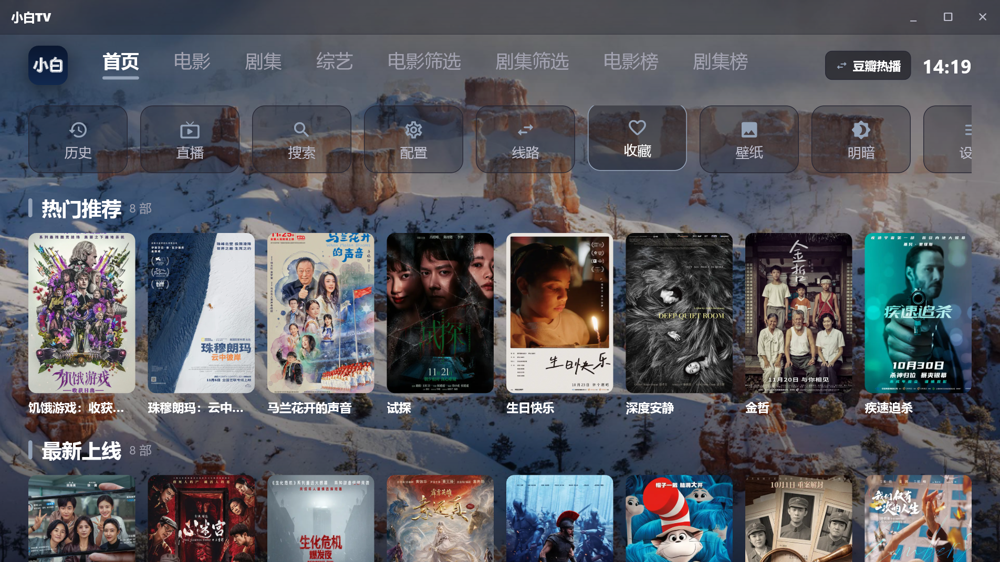
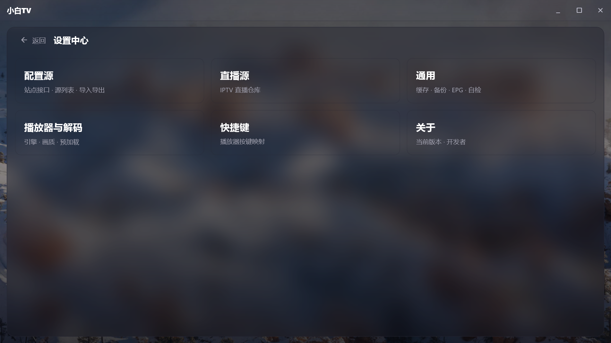

# 小白TV

一款Windows桌面端的TVBOX衍生版。

  

  
  
  

## 简介

本项目初衷是个人自用方便，软件本身不提供、不托管任何内容源，也不内置订阅链接；播放内容完全来自你自行添加的源地址。

## 核心亮点

- 可以使用安卓的TVBOX源，如：饭太硬，肥猫等大佬的源。
- 支持多仓源，点击首页的线路可以切换多仓源内的源地址。

## 界面截图

### 首页

  

顶部分类导航 + 功能入口方块 + 站点分类与海报网格；站点与分类都能一键切换。

  

尚未导入影视配置时显示空态占位，点击「立即配置影视源」即可添加订阅源。

### 播放历史

按时间倒序记录剧集与观看进度，点击即从上次位置续播；保留条数可配置（30–500，默认 150）。

### 设置

  

配置源、直播源、通用、播放器与解码、快捷键与关于集中在设置中心。

### 界面与交互

- 壁纸内置bing每日壁纸，点击首页的壁纸自动更换，无需复杂设置。
- 点击线路切换设置好的源地址，如果当前使用的是多仓源则切换多仓内部地址。
- 时间左侧的首页源切换按钮，点击切换源地址的首页源，如果调用失败则返回默认的豆瓣首页。
- 分类除了内置分类，还会读取源地址的分类，在顶部显示。
- 点击搜索会进入搜索界面，调用源地址的搜索结果。
- 点击明暗会切换界面深色和浅色。

## 参考来源

- 参考了（[FongMi/TV](https://github.com/FongMi/TV)）和（[xiugou-tv](https://github.com/qfw66/xiugou-tv)）的功能实现。
- 感谢这些项目贡献者。

## 许可证

本项目基于 GPL-3.0 协议发布。
